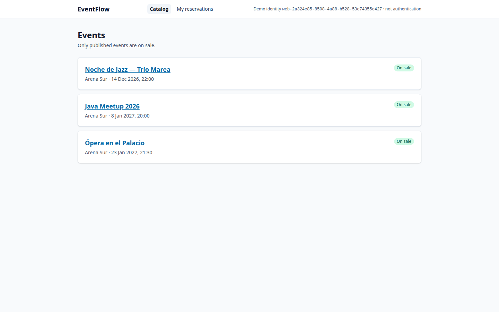
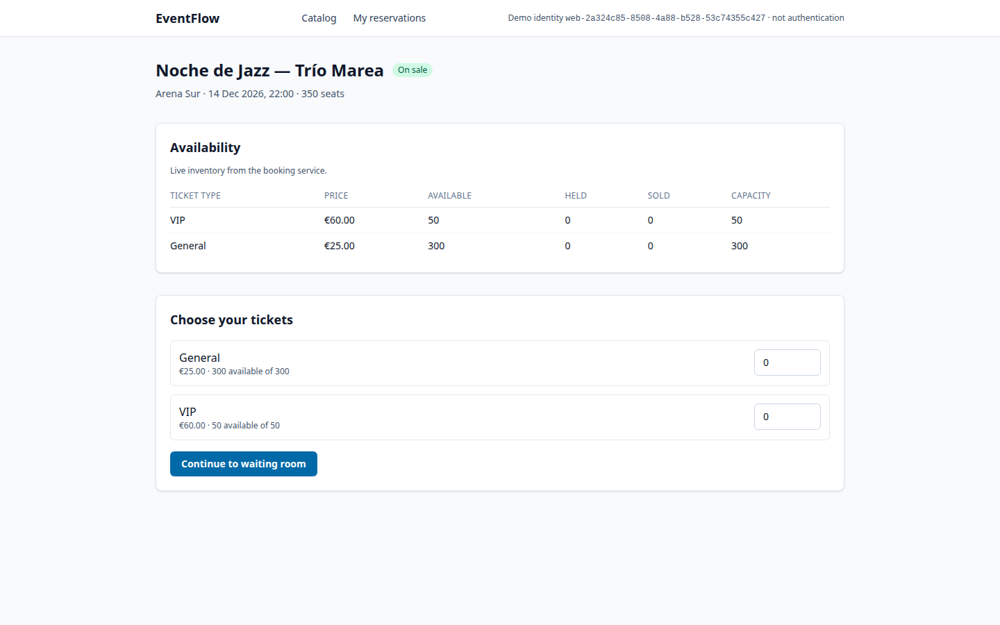
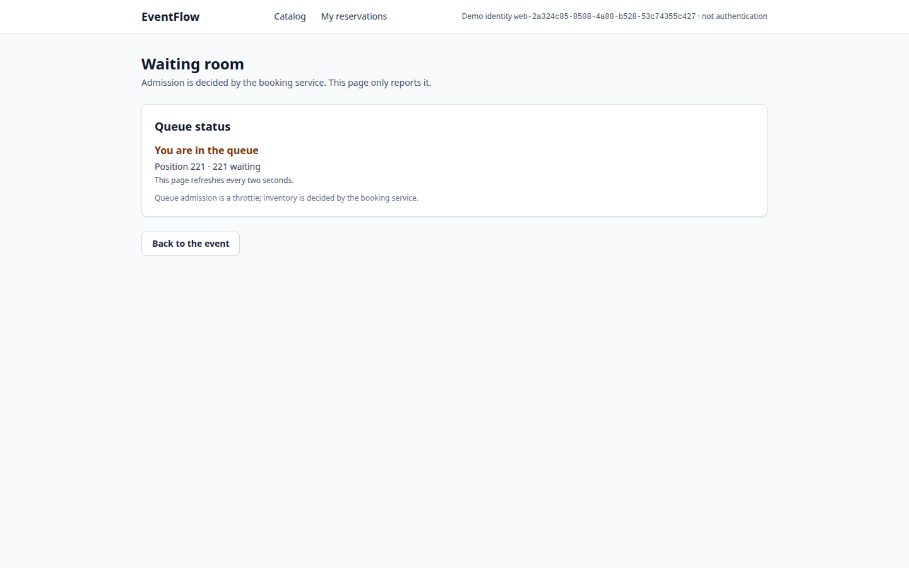
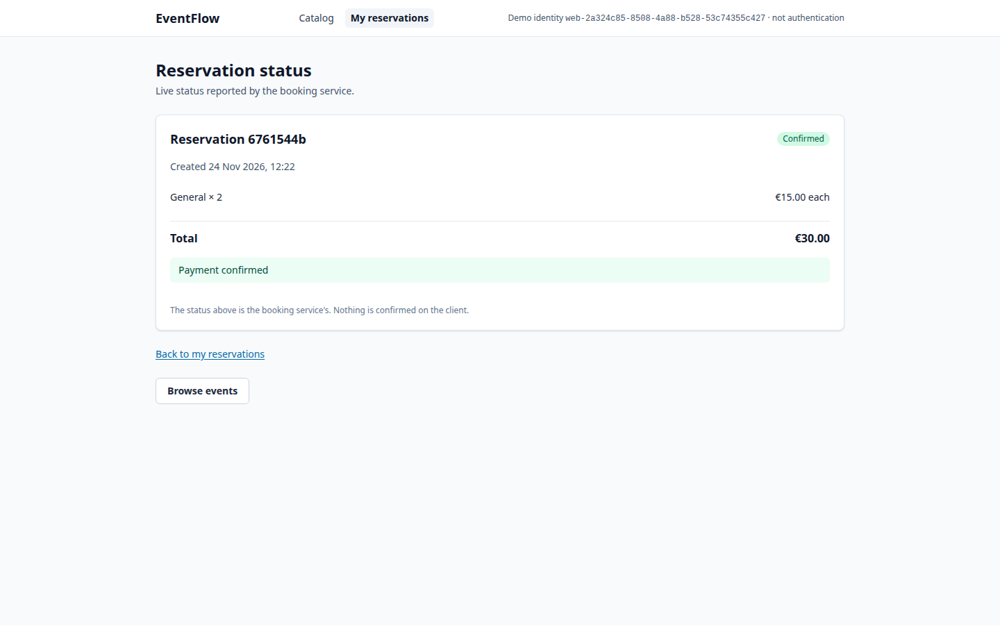
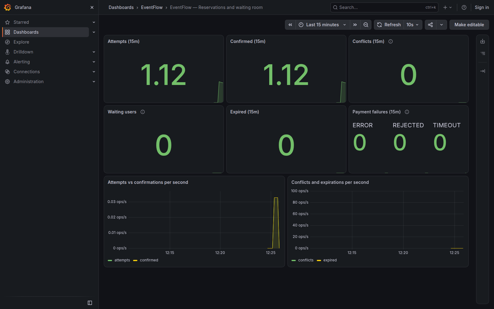
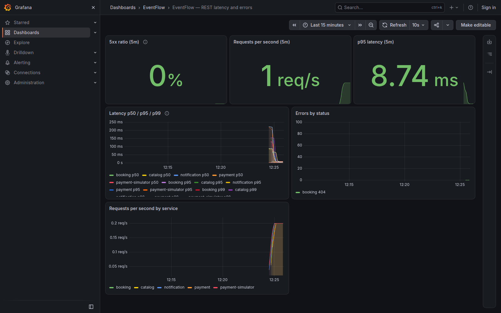

# EventFlow

A ticket-booking platform built as five Spring Boot services and a React SPA, where the interesting
part is not the CRUD: it is selling a limited stock correctly when 200 people press *buy* at the same
time, keeping a message from being lost when the broker dies, and compensating a payment that arrives
after the reservation expired. Every concurrency, idempotency and failure-handling claim on this page
is backed by a test you can run, not by an adjective.

**Status: Phases 0-8 complete** — bootstrap, Catalog, Booking, Events, Payment/Saga, Frontend +
Redis waiting room, Deployment (Compose and k3d), Observability (Prometheus, Grafana, OpenTelemetry,
Tempo) and Portfolio (CI, k6, ADRs, README).

## The problem it solves

A concert hall has 300 seats and a marketing campaign that sends 10,000 people to the same page at
the same minute. Three things go wrong in systems like this, and each one is a design decision here:

1. **Overselling.** Two requests read `available = 1` and both write a hold. EventFlow never reads
   then writes: units move with one conditional `UPDATE`, and a database `CHECK` refuses any state
   where `available + held + sold ≠ capacity` (ADR 0006).
2. **Losing the sale in the gap between the database and the broker.** Writing the row and publishing
   the event are not atomic across two systems. EventFlow writes the event into the same transaction
   (`outbox_event`) and a relay publishes it with publisher confirms (ADR 0009). A broker outage
   delays a message; it cannot lose it.
3. **Charging someone for a ticket that was already released.** Payment is asynchronous, so an
   approval can arrive after the hold expired. EventFlow compensates instead of confirming: the
   reservation stays `EXPIRED`, the units stay released, and a refund is requested (ADR 0010).

Around those three sit a Redis waiting room that is a throttle and never the stock authority
(ADR 0011), a deterministic payment provider double, and one OpenTelemetry trace that crosses HTTP,
the outbox relay and the broker hops.

## Architecture

```
                    ┌──────────────┐
   React SPA ──────▶│    nginx     │  one origin: /, /api/catalog, /api/booking, /api/notification
   (browser)        │   :8080      │
                    └──────┬───────┘
        ┌──────────────────┼──────────────────┬────────────────────┐
        ▼                  ▼                  ▼                    ▼
   Catalog :8081      Booking :8082     Notification :8083   Payment :8084
   venues, events,    inventory,        user mailbox         authorization + refund
   publication        reservations,                            (no REST API)
                      waiting room
        │                  │                  ▲                    ▲
        └── outbox ────────┴── outbox ────────┴─── consumed ───────┘
                    ┌──────────────────────────────────┐
                    │ RabbitMQ  eventflow.events       │  topic exchange + per-queue retry
                    │ (+ .dlx, retry queues, DLQs)     │  queues with TTLs and DLQs
                    └──────────────────────────────────┘
   PostgreSQL: catalog_db · booking_db · notification_db · payment_db (one owner each)
   Redis: waiting-room queue, admission tokens, rate-limit windows (throttle only)
   Observability: Prometheus · Grafana (dashboards as code) · OTel collector · Tempo
```

The full message flow, with the routing keys and the compensation path, is in
[Event flow](#event-flow).

### The invariants behind it

| Invariant | Where it lives |
| --- | --- |
| PostgreSQL is the source of truth for stock and reservations; Redis never decides availability | ADR 0006, ADR 0011 |
| Each service owns its database; no shared entities, tables or repositories | ADR 0005 |
| Units move only through conditional statements, protected by a `CHECK` | ADR 0006 |
| Events leave through a transactional outbox; consumers are idempotent; delivery is at-least-once | ADR 0009 |
| Payment is a saga with an explicit compensation for late authorizations | ADR 0010 |
| Business rules live in aggregates, never in controllers, listeners or scripts | ADR 0005 |

## How each claim is proven

| Claim | Test | Command |
| --- | --- | --- |
| 100 units, 200 simultaneous holds: exactly 100 held, never negative, `available + held + sold = capacity` | `ReservationConcurrencyTest` | `./gradlew :booking:test --tests "*ReservationConcurrencyTest"` |
| A stopped broker leaves the event in the outbox and the relay publishes it when the broker returns | `EventPublicationIntegrationTest` | `./gradlew :booking:test --tests "*EventPublicationIntegrationTest"` |
| A duplicate delivery produces one effect; an unreadable event ends in the DLQ | `NotificationConsumerTest`, `EventPublishedConsumerTest` | `./gradlew :notification:test` |
| Payment approves, rejects, times out, survives a duplicate and compensates a late authorization | `PaymentConsumerTest`, `PaymentSagaIntegrationTest`, `PaymentGatewayCircuitBreakerTest` | `./gradlew :payment:test` |
| The waiting room admits in batches, tokens expire, two replicas share one window, a Redis restart never oversells | `WaitingRoomIntegrationTest`, `WaitingRoomRateLimitTest`, `RateLimitSharedStateTest`, `WaitingRoomRedisOutageTest` | `./gradlew :booking:test` |
| The SPA walks catalog → waiting room → reservation → payment → mailbox with no simulated confirmation | `criticalFlow.test.tsx` | `cd frontend && npm test` |
| One trace links the Booking request, the broker hops, the payment and the notification consumer | `observability-verify.sh` | `./scripts/observability-verify.sh` |
| The pipeline runs the real gates, with pinned actions and no load test per PR | `ci-invariants-test.sh` | `./scripts/ci-invariants-test.sh` |
| The documented flow works end to end on the running stack | `demo.sh` | `./scripts/demo.sh` |
| Under a 200-attempt burst on 50 units, exactly 50 holds are created and the sum still equals capacity | `reservation-contention` scenario | `./scripts/load-test.sh reservation-contention` |

## Performance

Two k6 scenarios, measured on this machine and committed with their raw results
([`docs/performance`](docs/performance/README.md)):

| Scenario | Result on the recorded run |
| --- | --- |
| `read-path` — event list + availability at 20 iterations/s | 0 % failed, avg 2.6 ms, p95 3.1 ms |
| `reservation-contention` — 40 VUs × 5 attempts on 50 units | exactly 50 holds created, 150 refused, `0 + 50 + 0 = 50` after the run |

Those numbers describe one host and one warm stack; the README of the scenarios says what they do
**not** prove.

## Screenshots

Taken from the running Compose stack with a headless browser, so they are the real UI and the real
metrics, not mockups.

| | |
| --- | --- |
|  |  |
| Catalog: only `PUBLISHED` events, served by Catalog | Event detail: live availability from Booking, ticket form |
|  |  |
| Waiting room: position and waiting count from Redis, refreshed every 2 s | Reservation: `CONFIRMED` reported by Booking, payment status from the saga |
|  |  |
| Business dashboard: attempts, confirmations, conflicts, expirations, waiting users and the three provider failure reasons — provisioned from JSON, not clicked | REST dashboard: p50/p95/p99 per service, 5xx ratio and errors by status |

One trace per booking is proven by `./scripts/observability-verify.sh`, which asserts that a single
Tempo trace id carries spans from Booking, Payment and Notification and that the same id appears in
Booking's JSON log; a screenshot of a waterfall would add nothing a script cannot check.

## Stack

Versions are verified against Context7, Maven Central/npm metadata and official documentation
before being added (see `docs/adr/0001-version-stack.md`).

| Layer        | Technology                                          |
| ------------ | --------------------------------------------------- |
| Backend      | Java 21, Spring Boot 4.2.0, Spring MVC, Spring Data JPA |
| Build        | Gradle 9.9.2 (wrapper), version catalog             |
| Boilerplate  | Lombok 1.18.48 (build-time only, policy in ADR 0004) |
| Database     | PostgreSQL 18, Flyway 12.11.0 (managed by Boot)     |
| API docs     | springdoc-openapi 3.2.1 (Swagger UI)                |
| Messaging    | RabbitMQ 4.2, Spring AMQP 4.2 (AMQP 0.9.1), Outbox/Inbox |
| Resilience   | Resilience4j 2.4.0 circuit breaker, Boot `RestClient` |
| Throttle     | Redis 8 (waiting room, admission tokens, rate limit; ADR 0011) |
| Frontend     | React 19.3.1, Vite 8.3.8, TypeScript 5.9.3, Tailwind CSS 4.3.5, TanStack Query 5.108.1 (ADR 0012) |
| Tests        | JUnit 6, AssertJ, Testcontainers 2.0.5, Awaitility; Vitest 5 + Testing Library |
| Local infra  | Docker Compose (PostgreSQL + RabbitMQ + Redis, profile `core`) |
| Deployment   | Container images (multi-stage, non-root), Compose profile `app`, k3d + Traefik (ADR 0013) |
| Observability | Micrometer + Prometheus, Grafana dashboards as code, OpenTelemetry → Collector → Tempo (ADR 0014) |

## Prerequisites

- JDK 21 (`java -version` must report 21). If `java` is not on your `PATH`, export
  `JAVA_HOME` pointing to a JDK 21 installation; the Gradle wrapper reads it.
- Docker with Compose v2
- Node.js 22+ and npm 11 for the frontend (`frontend/package-lock.json` is committed)

Gradle is not required: use the wrapper.

## Quick start

Infrastructure first; this command returns when the containers are up:

```bash
cp .env.example .env
docker compose --profile core up -d  # PostgreSQL :5432, RabbitMQ :5672 (UI :15672), Redis :6379
```

Every service command below is a **long-running foreground process**: run each one in its own
terminal and leave it running. `./gradlew :catalog:bootRun` prints the Spring banner and then stays
at Gradle's `80% EXECUTING` progress bar — that is the task serving requests, not a hang, and the
command does not return until you press `Ctrl+C`. The SPA is also a foreground process.

| Terminal | Command | Serves |
| -------- | ------- | ------ |
| 1 | `./gradlew :catalog:bootRun` | Catalog API on `:8081` |
| 2 | `./gradlew :booking:bootRun` | Booking API on `:8082` |
| 3 | `./gradlew :notification:bootRun` | Notification API on `:8083` |
| 4 | `./gradlew :payment-simulator:bootRun` | Simulated provider on `:8085` |
| 5 | `./gradlew :payment:bootRun` | Payment service on `:8084` (internal, no REST API) |
| 6 | `cd frontend && npm ci && npm run dev` | SPA on `http://localhost:5173` |

From any other terminal, confirm the backend is up:

```bash
for port in 8081 8082 8083 8084 8085; do curl -fsS "localhost:$port/actuator/health"; echo; done
```

Or start the five services and the SPA together in the background, with one log per process under
`build/dev/`:

```bash
./scripts/dev-up.sh     # infrastructure, missing databases, jars, services, SPA; waits until ready
./scripts/dev-down.sh   # stop what dev-up started (add --infra to stop the containers too)
tail -f build/dev/catalog.log
```

A service that is already healthy on its port is reused and not touched by `dev-down`.

### Run the whole system in containers

The same system also runs as images, with no Gradle or Node process on the host. Only the front
door publishes a port, and nginx performs the same `/api/*` prefix rewrite Vite does in
development:

```bash
./scripts/stack-up.sh      # build and start profiles "core" and "app", wait for every healthcheck
./scripts/stack-verify.sh  # the documented flow through http://localhost:8080
./scripts/demo.sh          # the same flow as a narrated walkthrough, asserting every state
./scripts/stack-down.sh    # stop the containers (add --volumes to delete PostgreSQL/RabbitMQ data)
```

Everything is served from `http://localhost:8080`: the SPA at `/`, and `/api/catalog`,
`/api/booking`, `/api/notification` on the same origin. `APP_PORT` in `.env` changes the published
port. The images are `eventflow/<service>:${EVENTFLOW_TAG:-local}`, built by
`docker/service.Dockerfile` (`ARG SERVICE`) and `frontend/Dockerfile` (ADR 0013).

### Observability (metrics, dashboards, traces)

The same system with Prometheus, Grafana, an OpenTelemetry collector and Tempo, as a Compose
profile. Traces are exported only in this stack, because it is the only one with a collector:

```bash
./scripts/observability-up.sh      # core + app + observability, tracing on, waits for the stack
./scripts/observability-verify.sh  # runs the documented flow, then proves the observability side
./scripts/observability-down.sh    # stop it (add --volumes to delete metrics and traces too)
```

- **Grafana** `http://localhost:3000` — four provisioned dashboards under the `EventFlow` folder:
  services and JVM, REST latency and errors, messaging with retries and DLQ, and the business view
  (attempts, confirmations, conflicts, expirations, waiting users, provider failures). They are JSON
  files in `deploy/observability/grafana/dashboards`, generated by `generate.py`; nothing is clicked
  into existence.
- **Prometheus** `http://localhost:9090` — scrapes every service on `/actuator/prometheus`, RabbitMQ
  on its own Prometheus listener (`:15692`, not the management port), and itself.
- **Traces** — a booking is one trace: the checkout request, the outbox relay, the broker hops, the
  payment and its simulator call, the result event and the notification consumer. Tempo is internal;
  open it from Grafana (Explore → Tempo) or let `observability-verify.sh` prove a trace exists.
- **Logs** are one JSON object per line (ECS) with `service.name`, `traceId`, `spanId` and, in a
  consumer, `eventId` and `reservationId`.

`observability-verify.sh` is the phase gate in executable form: it runs the flow through the front
door, then asserts that the five service targets and RabbitMQ are up, that the business meters and
the HTTP latency buckets exist, that one Tempo trace links the Booking request to the Notification
consumer, that the four dashboards are loaded, and that Booking's JSON log line carries that same
trace id.

### Kubernetes (k3d)

The cluster deployment is self-contained — PostgreSQL, RabbitMQ and Redis run inside it, so nothing
from the Compose stack is reused — and it is where the differentiated probes, the resource limits
and the two Booking replicas live:

```bash
./scripts/k3d-up.sh    # cluster, images, kubectl apply -k deploy/k8s
./scripts/k3d-verify.sh
./scripts/k3d-down.sh               # stop the cluster, keep it for a fast restart
./scripts/k3d-down.sh --delete-cluster
```

Requires `k3d` and `kubectl` on `PATH`. The ingress answers on `http://localhost:8090`
(`K3D_INGRESS_PORT`), which leaves `8080` to Compose; Traefik routes and rewrites `/api/catalog`,
`/api/booking` and `/api/notification`, and `/` serves the SPA. Probes are
`/actuator/health/liveness` and `/actuator/health/readiness`, where readiness includes the database
and liveness never does. Credentials come from `.env`: `k3d-up.sh` creates the `eventflow-secrets`
Secret, so no credential is committed.

### Seed a demo event

The SPA lists only `PUBLISHED` events, and Booking provisions its inventory from `EventPublished`.
With the services running:

```bash
VENUE=$(curl -sS -X POST localhost:8081/api/venues -H 'Content-Type: application/json' \
  -d '{"name":"Arena Sur","address":"Calle 1, Madrid","capacity":5000}' | jq -r .id)
EVENT=$(curl -sS -X POST localhost:8081/api/events -H 'Content-Type: application/json' \
  -d "{\"name\":\"Java Meetup 2026\",\"venueId\":\"$VENUE\",\"startsAt\":\"2026-12-01T19:00:00Z\",\"ticketTypes\":[{\"name\":\"General\",\"price\":25.00,\"capacity\":400},{\"name\":\"VIP\",\"price\":60.00,\"capacity\":50}]}" \
  | jq -r .id)
curl -sS -X POST localhost:8081/api/events/$EVENT/publish
curl -sS localhost:8082/api/events/$EVENT/availability   # after the event reaches Booking
```

`jq` only extracts the ids; copy them from the JSON response if you prefer.

The SPA talks to its own origin: Vite proxies `/api/catalog` → `:8081`, `/api/booking` → `:8082`
and `/api/notification` → `:8083` in both `dev` and `preview`, so no CORS configuration is needed
(ADR 0012). `npm run build` produces the static bundle in `frontend/dist`.

One PostgreSQL instance hosts one database per service (`catalog_db`, `booking_db`,
`notification_db`, `payment_db`). A fresh volume gets all four from
`docker/postgres/init/01-create-databases.sh`. An existing volume from an earlier phase may lack
the newest ones (Notification or Payment then fails at startup with
`database "notification_db" does not exist`); create the missing databases without touching data:

```bash
docker compose exec -T postgres sh /docker-entrypoint-initdb.d/01-create-databases.sh
```

The script is idempotent: it only creates what is absent.

- Swagger UI: `http://localhost:8081/swagger-ui.html`, `:8082`, `:8083`
- OpenAPI JSON: `http://localhost:8081/v3/api-docs`, `:8082`, `:8083`
- Health: `http://localhost:8081/actuator/health`, `:8082`, `:8083`, `:8084`, `:8085`
  (`/actuator/health/liveness` and `/actuator/health/readiness` are the probe paths)
- RabbitMQ management UI: http://localhost:15672 (`eventflow` / `eventflow`)

## Tests

```bash
./gradlew build                  # compiles, runs unit + integration tests of every service
./gradlew :catalog:test          # one service
./gradlew :booking:test
./gradlew :notification:test
./gradlew :payment:test
./gradlew :payment-simulator:test

cd frontend && npm ci
cd frontend && npm run format:check   # Prettier
cd frontend && npm run lint           # ESLint (typescript-eslint + react-hooks)
cd frontend && npm test               # Vitest + Testing Library
cd frontend && npm run build          # tsc -b + Vite production build

./scripts/ci-invariants-test.sh       # the CI contract, statically (43 checks + actionlint)
./scripts/demo.sh                     # the documented flow, asserted, against a running stack
./scripts/load-test.sh read-path      # k6, see docs/performance
```

`./gradlew build`, the four frontend commands and the image builds are what CI runs on every pull
request (`.github/workflows/ci.yml`); load tests are deliberately not part of it.

Integration tests start real PostgreSQL, RabbitMQ and Redis containers through Testcontainers, and
the Payment tests talk to a real HTTP provider double. No H2, no in-memory database, no mocked
broker and no mocked Redis are used anywhere (see `docs/adr/0003-test-strategy.md`). The messaging
tests prove the Phase 3 gate (a stopped broker leaves the event in the outbox; duplicates produce a
single effect), the Phase 4 gate (approved, rejected, timeout, duplicated event and late payment)
and the Phase 5 gate (join, position, batch admission, token expiry, two-replica rate limit and a
Redis restart that loses the queue without overselling).

## API (Catalog)

| Method | Path                              | Description                                  |
| ------ | --------------------------------- | -------------------------------------------- |
| POST   | `/api/venues`                     | Create a venue                               |
| GET    | `/api/venues`                     | List venues                                  |
| POST   | `/api/events`                     | Create an event in `DRAFT` with ticket types  |
| GET    | `/api/events?from=&to=&page=&size=` | Paginated list of `PUBLISHED` events       |
| GET    | `/api/events/{eventId}`           | Event detail with ticket types               |
| POST   | `/api/events/{eventId}/publish`   | Publish a `DRAFT` event                      |

Errors use `application/problem+json` (RFC 9457) with `code` and `traceId` extensions.
`X-Request-Id` is echoed back and used as `traceId` when present.

### Example

```bash
curl -s -X POST localhost:8081/api/venues -H 'Content-Type: application/json' -d '{
  "name": "Arena Sur", "address": "Calle 1, Madrid", "capacity": 5000
}'

curl -s -X POST localhost:8081/api/events -H 'Content-Type: application/json' -d '{
  "name": "Java Meetup 2026",
  "venueId": "<venue-id>",
  "startsAt": "2026-12-01T19:00:00Z",
  "ticketTypes": [
    { "name": "General", "price": 25.00, "capacity": 400 },
    { "name": "VIP", "price": 60.00, "capacity": 50 }
  ]
}'

curl -s -X POST localhost:8081/api/events/<event-id>/publish
```

## API (Booking)

| Method | Path                                        | Description                                         |
| ------ | ------------------------------------------- | --------------------------------------------------- |
| GET    | `/api/events/{eventId}/availability`        | Capacity/available/held/sold per ticket type        |
| POST   | `/api/waiting-room/{eventId}/join`          | Join the queue; returns position or admission token |
| GET    | `/api/waiting-room/{eventId}/status`        | Poll the position; returns `NOT_JOINED`, `WAITING` or `ADMITTED` |
| POST   | `/api/reservations`                         | Hold units; requires `X-User-Id` + `Idempotency-Key` and, while the event has a queue, `X-Admission-Token` |
| GET    | `/api/reservations/{reservationId}`         | Read the caller's reservation                       |
| POST   | `/api/reservations/{reservationId}/checkout` | `HELD -> PENDING_PAYMENT` and request the payment  |
| POST   | `/api/reservations/{reservationId}/cancel`  | Cancel a `HELD` reservation and release its units   |

Inventory is authoritative in PostgreSQL: units move `available → held` with one conditional
`UPDATE`, and a database `CHECK` keeps `available + held + sold = capacity` (ADR 0006). The
expiry worker returns units from overdue holds; `Idempotency-Key` makes a retried creation
return the original response instead of holding twice.

A reservation is `HELD` until the user pays. `checkout` requests the payment (`PaymentRequested`);
the payment result then moves it to `CONFIRMED` (units `held → sold`) or `PAYMENT_FAILED` (units
back to `available`). A reservation whose hold expires — `HELD` or `PENDING_PAYMENT` — becomes
`EXPIRED`, and an authorization that arrives afterwards is compensated with a refund instead of
selling released inventory (ADR 0010). `cancel` is only allowed while `HELD`.

Booking never learns an offering over HTTP: publishing the event in Catalog writes
`EventPublished` to the outbox, the relay publishes it, and Booking's consumer provisions the
inventory (ADR 0009). Give the broker a second to deliver before reserving.

```bash
# Publish in Catalog first; Booking provisions inventory from EventPublished.
curl -s -X POST localhost:8081/api/events/<event-id>/publish

EVENT=<event-id>
TYPE=<ticket-type-id>

# Join the waiting room, poll until ADMITTED and keep the token.
curl -s -X POST localhost:8082/api/waiting-room/$EVENT/join -H 'X-User-Id: demo-user'
curl -s localhost:8082/api/waiting-room/$EVENT/status -H 'X-User-Id: demo-user'

# With a queue active, the admission token is required; without one the gate is off.
curl -s -X POST localhost:8082/api/reservations \
  -H 'Content-Type: application/json' \
  -H 'X-User-Id: demo-user' -H 'Idempotency-Key: order-1' \
  -H 'X-Admission-Token: <token>' \
  -d "{\"eventId\":\"$EVENT\",\"items\":[{\"ticketTypeId\":\"$TYPE\",\"quantity\":2}]}"

curl -s localhost:8082/api/events/$EVENT/availability
```

### Waiting room (Redis)

`POST /api/waiting-room/{eventId}/join` inserts the user once with a server-assigned position;
`GET .../status` is the poll the SPA uses. A scheduled dispatcher admits a batch per event while
PostgreSQL says the event still has `available > 0`, and writes a short-lived admission token. While
the event has a queue, `POST /api/reservations` requires a live `X-Admission-Token` for that user
(`403 NOT_ADMITTED` otherwise); without a queue there is no wait to skip and the gate is off. Join
and reservation creation are rate limited per user in Redis (`429` + `Retry-After`). Redis is a
throttle, never the stock authority: a Redis restart loses the queue but the sale stays correct,
and while Redis is down the gate and limiter fail open (ADR 0011). The counters live in Redis, so
two Booking replicas share the same window; a test starts a second application instance to prove
it.

## Frontend

`frontend/` is a React 19 + TypeScript SPA built with Vite and styled with Tailwind CSS 4.

| Route | Screen |
| ----- | ------ |
| `/` | Published events with loading, empty and error states |
| `/events/:id` | Event detail, live availability and the ticket form (React Hook Form + Zod) |
| `/events/:id/waiting-room` | Position, waiting count and admission polling every 2 s |
| `/events/:id/reserve` | Hold summary, countdown, checkout and live payment status |
| `/reservations` | Locally remembered reservations with live status and the notification mailbox |
| `/reservations/:id` | One reservation and its payment status |

The demo user id lives in `localStorage` and is sent as `X-User-Id`; it is not authentication. No
confirmation is simulated: every status comes from Booking and the mailbox from Notification.
Commands: `npm ci`, `npm run dev`, `npm test`, `npm run build`, `npm run preview` (the preview
keeps the same proxy). Versions are pinned in `frontend/package.json` and
`frontend/package-lock.json` (ADR 0012).

## Payment (internal) and its simulator

Payment exposes no REST API: it consumes `payment.requested` and `payment.refund-requested` and
publishes `payment.authorized` or `payment.rejected`. Each reservation gets one logical payment, at
most one settled authorization and one audit row per answered provider call (`payment_attempt`);
the call runs inside the consumer transaction, so a timeout rolls the inbox, the payment and the
result event back together and the broker retries instead of finalizing a payment nobody answered.

The provider is the `:payment-simulator` app, a deterministic HTTP double. Its outcome depends on
the amount, so tests and demos need no shared switch:

| Amount                | Answer                                                       |
| --------------------- | ------------------------------------------------------------ |
| below `10.00`         | `REJECTED` (simulated decline)                               |
| cents `.98`           | HTTP `503` (provider outage; the breaker absorbs it)         |
| cents `.99`           | approves after `PAYMENT_SIMULATOR_TIMEOUT_DELAY` (client read timeout) |
| anything else         | `APPROVED`                                                   |

The gateway wraps every call in a Resilience4j circuit breaker (`PAYMENT_CB_*`): after the minimum
number of failed calls it opens, fails fast without calling the provider and lets the message wait
in its retry queue. HTTP timeouts come from `spring.http.clients.*`
(`PAYMENT_PROVIDER_CONNECT_TIMEOUT` / `PAYMENT_PROVIDER_READ_TIMEOUT`). Late authorizations are
compensated: Booking publishes `PaymentRefundRequested` and Payment marks the payment `REFUNDED`.

```bash
# Continue the booking example: request the payment, then watch the reservation and the broker.
RESERVATION=<reservation-id>
curl -s -X POST localhost:8082/api/reservations/$RESERVATION/checkout -H 'X-User-Id: demo-user'
curl -s localhost:8082/api/reservations/$RESERVATION -H 'X-User-Id: demo-user'
```

## API (Notification)

| Method | Path                                     | Description                          |
| ------ | ---------------------------------------- | ------------------------------------ |
| GET    | `/api/notifications?userId=&page=&size=` | A user's mailbox, newest first       |

Notification has no write endpoint: entries are created only by consuming `booking.confirmed`,
`booking.cancelled`, `booking.expired` and `booking.payment-failed`. `userId` is required
(`400 USER_ID_REQUIRED` when it is missing or blank), `page` starts at `0` and `size` accepts
`1..100`.

## Event flow

```
Catalog ──outbox──▶ eventflow.events ──▶ booking.event-published ──▶ Booking (inventory)
Booking ──outbox──▶ eventflow.events ──▶ payment.payment-requested ─▶ Payment (provider call)
Payment ──outbox──▶ eventflow.events ──▶ booking.payment-result ────▶ Booking (confirm/compensate)
Booking ──outbox──▶ eventflow.events ──▶ notification.booking-events ─▶ Notification (mailbox)
Booking ──outbox──▶ eventflow.events ──▶ payment.payment-requested ─▶ Payment (refund)
```

- **Producer side (ADR 0009):** every event is written to `outbox_event` in the same transaction as
  its business change. A relay publishes with publisher confirms and marks the row published only
  after the confirm, so a broker outage delays delivery instead of losing the event.
- **Consumer side:** the inbox row `(consumer_name, event_id)` commits with the business effect, so
  a redelivery is a no-op. Malformed envelopes and unknown `eventVersion`s are rejected at once.
- **Retries:** each consumer queue has three retry queues (TTL `5s`, `15s`, `45s`); after the last
  attempt the message lands in `<queue>.dlq`. The recoverer writes the attempt number into the
  message (`x-eventflow-retry-attempt`), so the history survives the republish, a broker restart
  and several replicas. Configure the delays with `EVENTFLOW_RETRY_DELAYS`.
- Delivery is at-least-once, never exactly-once; the mailbox is idempotent by construction.

## Repository layout

```
services/catalog/     Catalog service (venues, events, ticket types, publication)
  src/main/java/com/eventflow/catalog/
    event/            Event aggregate: Event, TicketType, repository, service, controller, dto/
    venue/            Venue aggregate: Venue, repository, service, controller, dto/
    shared/           Cross-slice primitives: exceptions, RFC 9457 handler, page envelope,
                      messaging (envelope, outbox and relay)
    config/           Clock, OpenAPI and the RabbitMQ exchange
services/booking/     Booking service (inventory, reservations, expiration, payment saga)
  src/main/java/com/eventflow/booking/
    inventory/        EventInventory, conditional hold/release/confirm, provisioning, availability
    reservation/      Reservation aggregate, idempotent creation, checkout, cancel, expiry worker,
                      payment-result consumer and refund compensation
    shared/           Cross-slice primitives: exceptions, RFC 9457 handler, CurrentUserProvider,
                      messaging (envelope, outbox, relay, inbox, retry topology, recoverer)
    config/           Clock, OpenAPI, BookingProperties and the listener container factories
services/payment/     Payment service (simulated provider authorization, circuit breaker, refund)
  src/main/java/com/eventflow/payment/
    payment/          Payment aggregate, attempts, consumer, outbox, topology
    provider/         PaymentGateway and its HTTP implementation behind the circuit breaker
    shared/           Cross-slice primitives and messaging (envelope, outbox, relay, inbox)
    config/           Clock, PaymentProperties, RestClient + circuit breaker, listener recoverer
services/payment-simulator/ Deterministic HTTP provider double (no database, no events)
services/notification/ Notification service (user mailbox)
  src/main/java/com/eventflow/notification/
    notification/     Notification entity, booking-events consumer, REST mailbox
    shared/           Cross-slice primitives and messaging (envelope, inbox, retry topology)
    config/           Clock, OpenAPI and the listener recoverer
frontend/             React SPA (Vite, TypeScript, Tailwind)
  src/api/            Typed clients for the three services and the problem+json parser
  src/features/       catalog, waiting-room, reservation, notifications, identity
  src/components/     Layout and shared presentational pieces
  src/hooks/          Countdown and other client hooks
  src/routes/         Route table
docs/                 Product specification, roadmap, ADRs, performance notes
docs/assets/          Screenshots taken from the running stack
docs/performance/     k6 scenarios, the runner's results and what they do not prove
odd/tasks/            Feature/task tracking documents
docker/service.Dockerfile  Multi-stage image for any service (`--build-arg SERVICE=`)
docker/postgres/init/ One database per service on a fresh volume
deploy/k8s/           kustomize project applied by scripts/k3d-up.sh
scripts/              dev-up/dev-down (host), stack-up/verify/down, demo, load-test, observability-*,
                      k3d-*, and the invariant suites (deployment, observability, CI)
deploy/observability/ Prometheus, Grafana (dashboards as code), collector and Tempo configuration
.github/workflows/    CI: frontend gates, the full Gradle suite and the six images
compose.yaml          Infrastructure (profile: core) and the images (profile: app)
```

## Conventions

- **Constructor injection, no field injection.** Dependencies are `final` fields, generated
  by Lombok's `@RequiredArgsConstructor`. A single constructor needs no `@Autowired`: Spring
  injects it implicitly. This keeps components testable without a Spring context, makes a
  missing bean fail at startup instead of at first use, and prevents mutable dependencies.
- **One package per aggregate** with its entity, repository, service, controller and DTOs
  (ADR 0005). `shared/` holds primitives only.
- **Lombok policy:** getters, JPA constructors, injection constructors and loggers only; no
  `@Data`/`@Setter`/`@Builder` on entities and no Lombok on records (ADR 0004).
- **Errors:** every failure returns `application/problem+json` with a stable `code` and the
  request `traceId`.

## What this is not

Being explicit about the limits is part of the design:

- **Not authentication.** `X-User-Id` is a browser-local demo identity, clearly labelled as such in
  the UI. It would be the first thing to replace with a real identity provider.
- **Not exactly-once.** Delivery is at-least-once with idempotent consumers; the README and ADR 0009
  never claim otherwise.
- **Not a horizontally-scaled deployment.** k3d runs two Booking replicas to prove the Redis rate
  limit is shared and that probes distinguish liveness from readiness, but the database and the
  broker are single instances with no failover story.
- **Not measured beyond this machine.** The k6 numbers describe one i5-10400F host; there is no soak
  test, no multi-host run and no capacity claim ([`docs/performance`](docs/performance/README.md)).
- **Not a production payment integration.** The provider is a deterministic HTTP double whose
  outcome depends on the amount, so tests and demos need no shared switch.
- **Out of scope by design:** Kafka, Event Sourcing, Keycloak, a service mesh and a cloud deployment.

## Roadmap

| Phase | Scope                                    | Status      |
| ----- | ---------------------------------------- | ----------- |
| 0     | Bootstrap: monorepo, Compose, conventions | done        |
| 1     | Catalog: REST, JPA, Flyway, OpenAPI       | done        |
| 2     | Booking: inventory, reservations, expiry  | done        |
| 3     | Events: RabbitMQ, Outbox/Inbox, Notification | done      |
| 4     | Payment: saga, simulator, resilience       | done        |
| 5     | Frontend: React SPA, Redis waiting room     | done        |
| 6     | Deployment: Compose and k3d                | done        |
| 7     | Observability: Prometheus, Grafana, OTEL   | done        |
| 8     | Portfolio: k6, CI, ADRs, demo              | done        |

## Documentation

- `EVENTFLOW_HANDOFF.md` — project index and non-negotiable invariants
- `docs/01-arquitectura.md` … `docs/07-opencode.md` — product specification
- [`docs/adr/README.md`](docs/adr/README.md) — every architecture decision record, indexed
- [`docs/performance/README.md`](docs/performance/README.md) — the k6 scenarios, the runner and the
  measured results
- `odd/tasks/` — one document per phase: specs, tasks, evidence and the decisions taken while building
  it
