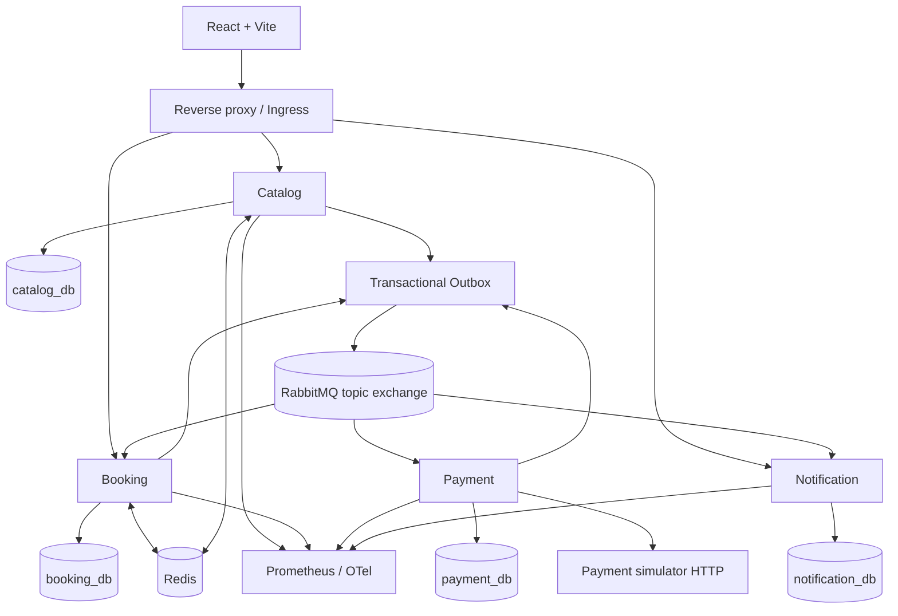

# 01 — Producto y arquitectura

## Producto

EventFlow permite descubrir eventos, consultar entradas, acceder a una sala de espera, retener entradas durante unos minutos y completar una compra mediante un proveedor de pago simulado. Resuelve el problema de los picos de demanda sin vender más entradas de las disponibles.

## Servicios y propiedad

| Servicio | Responsabilidad | Datos propios |
|---|---|---|
| Catalog | Recintos, eventos, tipos/precios de entrada y publicación. | `catalog_db` |
| Booking | Inventario, reservas, expiración, checkout y confirmación. | `booking_db` |
| Payment | Intentos de pago y comunicación con simulador HTTP. | `payment_db` |
| Notification | Buzón de notificaciones de usuario. | `notification_db` |

En local puede haber una instancia PostgreSQL con cuatro bases de datos. Ningún servicio consulta directamente la base de otro. La información necesaria se replica mediante eventos.

## Arquitectura

## Comunicación

- REST síncrono: navegador → servicios; Payment → proveedor simulado.
- RabbitMQ asíncrono: integración entre servicios; eventos versionados.
- Redis: sala de espera, rate limit y caché de catálogo. No es almacenamiento autoritativo.

## Stack objetivo

- Backend: Java 21, Spring Boot 4.x, Gradle Wrapper, Spring MVC, Spring Data JPA, PostgreSQL, Flyway.
- Mensajería: RabbitMQ 4.x y Spring AMQP clásico AMQP 0.9.1.
- Frontend: React + TypeScript + Vite + Tailwind; TanStack Query, React Hook Form y Zod.
- Calidad: JUnit, Mockito, Testcontainers, GitHub Actions.
- Plataforma: Docker Compose; k3d/Kubernetes; Prometheus, Grafana, OpenTelemetry Collector y Tempo; k6.

Elige versiones estables compatibles al iniciar. Consulta Context7 y documentación oficial. Spring Boot 4 reorganiza AMQP: para RabbitMQ AMQP 0.9.1 usa `spring-boot-starter-rabbitmq`; no confundas con `spring-boot-starter-amqp` (AMQP 1.0 genérico). Verifica la matriz de compatibilidad de cada integración antes de añadirla.

## Decisiones deliberadas

- SPA con Vite, no Next.js: la lógica de servidor vive en Java y no se necesita SSR.
- Sin API Gateway complejo en MVP: reverse proxy/Ingress basta.
- Sin Kafka, Redis Streams ni Event Sourcing: RabbitMQ + Outbox cubren el aprendizaje previsto.
- Identidad demo (`X-User-Id`) solo en local. Encapsularla en `CurrentUserProvider`; nunca presentarla como autenticación segura ni exponer demo públicamente.
