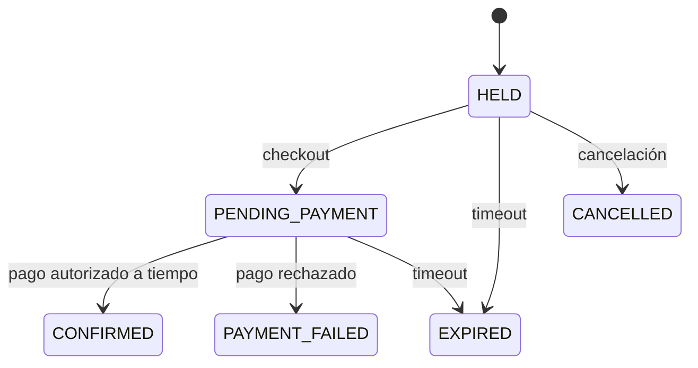

# 02 — Dominio, estados y datos

## Reglas de inventario

Para cada tipo de entrada: `capacity = available + held + sold`; todos los valores son enteros no negativos. Una reserva temporal mueve unidades de `available` a `held`; la confirmación las mueve de `held` a `sold`; rechazo, cancelación permitida o expiración las devuelve a `available`.

PostgreSQL es la fuente de verdad. Implementar la retención con una transacción y actualización condicional, por ejemplo:

```sql
UPDATE event_inventory
SET available = available - :qty, held = held + :qty
WHERE event_id = :eventId
  AND ticket_type_id = :typeId
  AND available >= :qty;
```

Si `rows_updated = 0`, no hay stock. Considerar bloqueo de fila o versión optimista cuando se procesen varias líneas; probar concurrencia real en PostgreSQL. Evitar el patrón leer-comprobar-actualizar sin protección.

## Estados de reserva



La transición de estado y el movimiento de inventario deben ser atómicos. Un evento tardío no puede confirmar una reserva expirada. Si el proveedor autorizó el pago después de expirar, marcar el pago como tardío y simular una compensación/reembolso; nunca vender inventario ya liberado.

## Tablas esenciales

**Catalog DB**
- `venue(id, name, address, capacity)`
- `event(id, venue_id, name, starts_at, status)`
- `ticket_type(id, event_id, name, price, initial_capacity)`
- `outbox_event(id, aggregate_id, event_type, payload, created_at, published_at)`

**Booking DB**
- `event_inventory(id, event_id, ticket_type_id, capacity, available, held, sold, version)`; unique `(event_id, ticket_type_id)`.
- `reservation(id, user_id, event_id, status, expires_at, created_at)`
- `reservation_item(id, reservation_id, ticket_type_id, quantity, unit_price)`
- `idempotency_request(user_id, idempotency_key, request_hash, response, created_at)`; unique `(user_id, idempotency_key)`.
- `processed_message(consumer_name, event_id, processed_at)`; unique `(consumer_name, event_id)`.
- `outbox_event(...)`.

**Payment DB:** `payment`, `payment_attempt`, `processed_message`, `outbox_event`. Un pago lógico por reserva; clave idempotente para el proveedor.

**Notification DB:** `notification(id, user_id, type, content, status, created_at)` y `processed_message`.

## Idempotencia

- API de creación de reserva exige `Idempotency-Key`. Misma clave + mismo payload devuelve el resultado original; misma clave + payload distinto devuelve conflicto.
- Consumidores registran `(consumer_name, event_id)` en la misma transacción que sus cambios de negocio.
- Outbox publica de forma recuperable; puede repetir un mensaje si falla después de publicar y antes de marcarlo enviado. Por tanto, consumidores idempotentes son obligatorios.

## Expiración

Un worker de Booking busca reservas vencidas por lotes y realiza una transición condicional (`HELD`/`PENDING_PAYMENT` → `EXPIRED`) junto con la liberación de inventario y el Outbox, todo en una transacción. Debe ser seguro con varias réplicas: bloqueo/claim por filas o actualización condicional. No confiar en TTL de Redis para liberar inventario.
